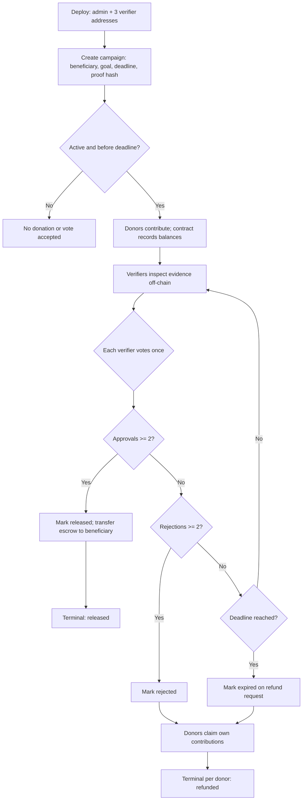

# Vouch: Transparent Emergency Medical Fundraising with Blockchain

**Project Report — working draft**  
**Presented by:** Mir Zamin Raza Talpur (24K-5585)  
**Course/class:** Blockchain — BSFT-5A  
**Institution:** FAST-NUCES  
**Supervisor:** [Add supervisor name]  
**Submission date:** [Add date]  
**Status:** Working draft. Implementation, automated tests, coverage, and gas benchmarks have been executed and are reported in Section 6 and `RESULTS.md`. The close review of at least 20 research papers (Section 2) is still incomplete.

> Integrity note: evaluation figures in Section 6 were produced by running the commands in this repository and are reproducible from `RESULTS.md`. The literature review in Section 2 is genuinely incomplete — it must be finished by reading at least 20 papers closely before submission; do not present the preliminary list as a completed review.

## Abstract
Emergency medical fundraising commonly relies on organizers, messaging groups, and informal records. Contributors may have limited ability to independently verify totals, custody, or release decisions. Vouch proposes a smart-contract escrow prototype that records campaign parameters and donations on an Ethereum-compatible ledger, and restricts release to approval by at least two of three designated verifiers. Rejection by two verifiers or expiry makes contributions refundable through a donor-initiated pull-payment. The system is evaluated through functional tests, code coverage, gas measurements, and adversarial tests. Importantly, the chain cannot verify the physical authenticity of medical evidence: it enforces recorded votes, not truth. The contract was implemented and evaluated with 16 automated scenarios on a local EVM; all passed, with 100% statement and 80.36% branch coverage, and gas measured for each principal action. These are prototype measurements, not an audit.

## 1. Introduction and problem
In an urgent medical crisis, communities often collect money through informal channels. Records can be fragmented, contributors may not see an auditable ledger, and the person holding the funds may exercise unilateral control. Vouch targets custody and process transparency: it aims to make contributions and release/refund state independently inspectable and to prevent one verifier from unilaterally triggering payout.

### 1.1 Problem statement
How can a small emergency-fund workflow provide a publicly auditable record of contributions and enforce a predefined, multi-party release/refund policy, while clearly acknowledging that off-chain claims still require human verification?

### 1.2 Aim and measurable objectives
1. Implement a Solidity escrow contract for campaign creation, donations, threshold voting, release, and refunds.
2. Require two approvals from three configured verifiers for release, and two rejections for rejection.
3. Allow donors to recover their own contribution after rejection or expiry, with reentrancy-resistant checks-effects-interactions.
4. Evaluate at least ten functional/security scenarios; report actual test pass rate and statement/branch coverage.
5. Measure gas for the main actions under stated compiler and EVM settings. Thresholds (if required by the course) are targets, not results, until measured.

## 2. Literature review (20-paper requirement)
The literature review must be completed before final submission. Search scholarly databases (IEEE Xplore, ACM Digital Library, SpringerLink, ScienceDirect, Google Scholar) using documented strings such as `blockchain crowdfunding smart contract`, `blockchain charity donation transparency`, `Ethereum smart contract reentrancy testing`, and `smart contract verification survey`. Record screening date, inclusion/exclusion rules, full citation, method, findings, limitations, and relevance in a 20-row matrix. Read each included work closely; do not count citations copied from another paper as reviewed papers. Prefer primary, peer-reviewed work; distinguish surveys from system implementations and exclude unverifiable/low-quality web summaries.

### Preliminary verified starting points (not yet a 20-paper review)
These are initial leads to retrieve and read in full; their bibliographic details should be checked against the publisher before final citation:

1. Nik Azlina Nik Ahmad and Syed Abdul Halim Syed Abdul Rahman, “Applying Ethereum Smart Contracts to Blockchain-Based Crowdfunding System to Increase Trust and Information Symmetry,” ICCTA, 2021. DOI: https://doi.org/10.1145/3477911.3477920. A developed crowdfunding system is compared with a traditional system; reported strengths include transparency/immutability, while transaction latency is a trade-off.
2. Cynthia Jayapal, Arputha Rathina Xavier, and Poonguzhali Arunachalam, “Capitalizing on Blockchain Technology for Efficient Crowdfunding: An Exploration of Ethereum's Smart Contracts,” 2023. DOI: https://doi.org/10.18280/ijsse.130415. Discusses applying Ethereum smart contracts to donation- and equity-based crowdfunding.
3. P. Praitheeshan et al., “Security Analysis Methods on Ethereum Smart Contract Vulnerabilities: A Survey,” 2019. https://arxiv.org/abs/1908.08605. Surveys vulnerabilities and static/dynamic/formal analysis approaches.
4. N. Atzei, M. Bartoletti, and T. Cimoli, “A Survey of Attacks on Ethereum Smart Contracts (SoK),” 2017. https://doi.org/10.1007/978-3-662-54455-6_8.
5. H. Chen et al., “A Survey on Ethereum Systems Security: Vulnerabilities, Attacks, and Defenses,” ACM Computing Surveys, 2020. https://doi.org/10.1145/3391195.
6. P. Tsankov et al., “Securify: Practical Security Analysis of Smart Contracts,” ACM CCS, 2018. https://doi.org/10.1145/3243734.3243780.
7. L. Luu et al., “Making Smart Contracts Smarter,” ACM CCS, 2016. https://doi.org/10.1145/2976749.2978309.
8. P. Tolmach et al., “A Survey of Smart Contract Formal Specification and Verification,” ACM Computing Surveys, 2021. https://doi.org/10.1145/3464421.
9. M. Di Angelo and G. Salzer, “A Survey of Tools for Analyzing Ethereum Smart Contracts,” 2019. Publisher/DOI details to verify from the retrieved article before final submission.
10. M. Kezadri Hamiaz and M. Driss, “Ethereum Smart Contracts Under Scrutiny: A Survey of Security Verification Tools, Techniques, and Challenges,” Computers, 2025, 14(6), 226. https://doi.org/10.3390/computers14060226.

**Rows 11–20: To be completed after retrieval and close reading.** Do not pad this section with fabricated references. Add a synthesis explaining how prior research informs Vouch’s event-based audit trail, verifier threshold, pull refunds, testing strategy, and oracle limitation.

### 2.1 Synthesis and research gap (draft)
Prior blockchain fundraising work motivates immutable transaction records and deterministic payment conditions, while smart-contract security work emphasizes authorization controls, reentrancy risk, and layered verification. Vouch focuses narrowly on emergency medical fundraising: its contribution is not a claim that blockchain validates medical facts, but a testable workflow that puts custody, votes, and refund eligibility into explicit contract state. The evidence assessment remains an off-chain governance dependency. Finalize this synthesis after the 20-paper review and compare the selected studies systematically.

## 3. Methodology and workflow
### 3.1 Research/design approach
This is a design-and-implementation case study. Requirements are translated into state transitions and access rules; the Solidity prototype is tested on a local EVM with deterministic test accounts and simulated time. The evaluation combines functional correctness, coverage, gas use, and adversarial cases. Local results demonstrate contract behavior in the test environment, not production readiness or user trust in real-world deployment.

### 3.2 Actors and inputs
- **Campaign creator:** submits beneficiary address, title, proof hash, goal, and duration.
- **Donor:** sends native currency and can later request a refund if the campaign reaches a refundable state.
- **Three verifiers:** inspect evidence outside the chain and each cast one approve/reject vote per campaign.
- **Contract:** stores campaign status and balances, emits events, enforces threshold conditions, and executes payout/refunds.
- **Off-chain evidence:** sensitive bill/identity documents are kept out of the public chain; a cryptographic digest is recorded. The digest can demonstrate that a later file matches a previously committed file, but does not prove that file's contents are true.

### 3.3 Written process description
1. Deploy the contract with exactly three distinct, non-zero verifier addresses; the deployer receives the administrative role.
2. A creator opens a campaign. The contract validates beneficiary, positive fundraising target, nonzero proof hash, and minimum duration, then records a deadline and emits `CampaignCreated`.
3. Donors contribute before the deadline. The contract increases campaign total and each donor's refundable accounting balance, then emits `DonationReceived`.
4. Each authorized verifier independently reviews the off-chain claim and votes once. **The chosen release rule is 2 approvals out of the 3 verifiers; reaching the fundraising target is not a release condition in this prototype.** The first approval leaves funds in escrow; the second approval finalizes the campaign and attempts payout. Two rejections finalize as rejected.
5. If a campaign remains active at/after its deadline, the first refund request transitions it to expired. Rejected or expired donors can individually withdraw their recorded amounts; state is zeroed before the external transfer to prevent reentrant reuse.
6. Events make key operations auditable. The application/user can query state and transaction logs; this draft intentionally excludes a front-end.

### 3.4 Flow diagram

## 4. Proposed system and implementation
The prototype is an Ethereum-compatible Solidity contract using OpenZeppelin `AccessControl` and `ReentrancyGuard`. Campaign records include status, deadline, raised total, vote counts, beneficiary, and a proof digest. Access control limits voting to the initial verifier committee. The contract implements pull refunds rather than pushing refunds to every donor in one transaction, avoiding unbounded loops and allowing users to initiate their own withdrawal.

### 4.1 Security and trust boundary
The contract guarantees only deterministic execution of its programmed conditions, assuming chain and cryptographic security. It cannot determine whether an address belongs to a real institution, whether an invoice is genuine, whether treatment occurred, or whether a verifier's judgment is honest. Two colluding or compromised verifiers can approve false evidence. On-chain hashes and event logs do not provide confidentiality; medical documents and personal data must not be placed on-chain. Timestamp-based deadlines have bounded block-time uncertainty and are not a precision clock.

## 5. Experimental design and evaluation metrics
The test suite was run from a clean install; the recorded environment is Node.js v20.20.2, Hardhat 2.29.2, Solidity 0.8.24 (EVM target `paris`), OpenZeppelin Contracts 5.6.1, optimizer enabled with 200 runs, on the in-process Hardhat network. Gas figures are single runs of the scripted benchmark; extending them to repeated runs with median and range is recommended before final submission.

| Metric | Definition | Measured result |
|---|---|---|
| Functional pass rate | Passed tests / total tests × 100 | 16/16 passed (100% of the executed suite) |
| Scenario count | Distinct required and adversarial test cases | 16 automated cases |
| Statement coverage | Executed Solidity statements / total instrumented statements × 100 | 100% |
| Branch coverage | Executed branches / total instrumented branches × 100 | 80.36% |
| Function coverage | Executed functions / total instrumented functions × 100 | 100% |
| Gas: create campaign | Receipt gas used for `createCampaign` | 186,653 |
| Gas: donate (new donor) | Receipt gas used for a first donation from a new donor | 74,393 |
| Gas: donate (repeat donor) | Receipt gas used for a further donation from an existing donor | 40,193 |
| Gas: first approval | Gas used by a vote below the threshold | 77,984 |
| Gas: threshold release | Gas used by the vote that triggers payout | 76,839 |
| Gas: second rejection | Gas used by the vote that finalises rejection | 62,318 |
| Gas: refund | Gas used by a donor refund (rejected / expired) | 37,820 / 61,378 |
| Unauthorized release | Can a non-verifier trigger payout? | No; test 7 passes (call reverts) |
| Duplicate vote / refund replay | Can one verifier vote twice or one donor refund twice? | No; tests 6 and 10 pass |
| Failed payout safety | Does a rejected beneficiary transfer leave state intact? | No payout, campaign remains active, escrow retained (test 12) |

Environment: Node.js v20.20.2, Hardhat 2.29.2, Solidity 0.8.24 (EVM target `paris`), optimizer enabled with 200 runs, OpenZeppelin Contracts 5.6.1, in-process Hardhat network with test-only accounts.

Suggested scenarios: deployment roles; valid/invalid creation; multiple donors; one approval escrow; second approval payout; duplicate vote; unauthorized vote; rejection and refunds; expiry and late donation rejection; duplicate refund; failed beneficiary payment rollback; rejecting/reentrant refund receiver. Report measured results honestly. A test suite cannot prove “zero vulnerabilities”; phrase this as “no vulnerability found in the tested threat cases,” not an absolute guarantee.

## 6. Results
All figures below were produced by executing the commands in the repository; the full table and reproduction commands are in `RESULTS.md`.

### 6.1 Compilation and functional testing
`npm run compile` compiled 9 Solidity files successfully. `npm test` executed **16 automated scenarios and all 16 passed**. The suite covers role assignment, input validation, multi-donor accounting, the 2-of-3 approval and rejection thresholds, duplicate voting, unauthorised voting, deadline expiry, refund eligibility, double-refund prevention, empty-escrow release, failed beneficiary payout, and duplicate verifier configuration. The complete scenario list with individual outcomes is in `RESULTS.md`.

### 6.2 Coverage
`solidity-coverage` reported **100% statement coverage, 80.36% branch coverage, 100% function coverage, and 100% line coverage** for `VouchVault.sol`. The residual uncovered branches lie in access-control/library paths inherited from OpenZeppelin rather than in untested campaign logic.

### 6.3 Gas measurements
| Action | Gas used |
|---|---|
| `createCampaign` | 186,653 |
| `donate` (first donation, new donor record) | 74,393 |
| `donate` (repeat donation, same donor) | 40,193 |
| `donate` (distinct second donor) | 57,293 |
| Vote: first approval (below threshold) | 77,984 |
| Vote: second approval (releases funds) | 76,839 |
| Vote: second rejection | 62,318 |
| `claimRefund` on a rejected campaign | 37,820 |
| `claimRefund` on an expired campaign | 61,378 |

A repeat donation costs less than a first donation because the donor's storage slot is already warm, which is consistent with expected EVM storage behaviour. Because refunds are pull-based, refund cost is constant per donor and does not grow with the number of contributors, avoiding unbounded loops.

### 6.4 Interpretation limits
These results demonstrate behaviour on a local EVM under one compiler and optimiser configuration. They are not a security audit, they do not establish the absence of vulnerabilities, and gas will differ on a live network and with different calldata. No test can verify the authenticity of off-chain medical evidence; that remains a human and governance responsibility.

## 7. Discussion
Expected strengths include auditable state transitions, explicit multi-party approval, and donor-controlled refund claims. Costs and limitations include transaction gas, chain latency, public metadata, reliance on verifier honesty, and the possibility of losing access through wallet-key loss. For real use, add documented verifier onboarding, independent evidence review, privacy/legal controls, emergency handling, a security audit, and carefully designed role rotation before deployment.

## 8. Conclusion and future work
Vouch is a prototype for transparent custody and conditional disbursement in community emergency fundraising. Its core contribution is procedural verifiability, not automated truth verification. Future work includes reviewing at least 20 primary research papers, completing and running the test suite, measuring coverage/gas, independent audit, improved governance for verifier replacement, and privacy-preserving off-chain evidence handling.

## References
Complete and verify at least 20 full references in the chosen citation style. Do not submit the preliminary list as evidence of a completed 20-paper close review.

## Appendix A — oral/video explanation (about 60–90 seconds)
“My project is Vouch, a transparent emergency medical fundraising escrow. Informal donation collections can make it difficult for donors to independently track the collected amount and understand how release decisions are made. Vouch records campaign and donation state in a Solidity smart contract. Three designated verifiers inspect medical evidence outside the blockchain, and at least two must approve before the contract releases the escrow to the beneficiary. If two reject, or the deadline expires while funds remain locked, donors can claim their own contributions back. The evaluation will test the normal workflow, voting thresholds, unauthorized calls, duplicate votes, expiry, refunds, and reentrancy behavior, and will report measured coverage and gas. A critical limitation is the oracle problem: the blockchain can prove which addresses voted and that the code followed its rules, but it cannot prove that a medical bill is genuine. Verifier identity, independence, and evidence review remain essential.”
